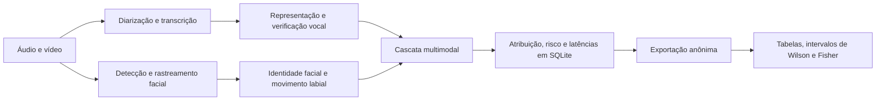

# Protocolo experimental

## 1. Objetivo e unidade de análise

O experimento caracteriza como a cascata multimodal atribui um locutor a cada
segmento aceito como fala e mede o tempo de processamento. A unidade de análise
é o segmento; a sessão é usada para estratificar os resultados conforme a
quantidade esperada de participantes.

## 2. Base e critérios

A base interna contém 106 sessões coletadas entre 16 de março e 22 de maio de
2026. Foram incluídas as 92 sessões com pelo menos um segmento aceito como fala
e excluídas 14 sessões vazias. O conjunto analisado contém 1.660 segmentos.

Distribuição das sessões: 19 com um participante, 7 com dois, 4 com três e 62
com quatro. As gravações não foram roteirizadas. Não foram coletadas variáveis
de idade, nacionalidade, origem étnico-cultural, gênero autodeclarado ou perfil
linguístico; por isso, o estudo não formula uma alegação de generalização
multicultural.

## 3. Fluxo do sistema

Para cada segmento, a primeira condição atendida determina a atribuição:

1. voz com confiança alta;
2. voz com confiança moderada;
3. voz com confiança baixa corroborada por evidência visual ou acústica;
4. detecção de locutor ativo;
5. identidade facial e coerência acústico-visual;
6. associações persistentes de diarização ou rastreamento da sessão.

Os tipos gravados no banco são agrupados da seguinte forma:

| Grupo público | Tipos internos |
|---|---|
| `voice_only` | `VERIFIER_HIGH`, `VERIFIER_MOD` |
| `voice_corroborated` | `VERIFIER_WEAK` |
| `active_speaker` | `ASD`, `ASD_GUESS` |
| `face_gender` | `SESSION_FACE`, `GENDER_FACE`, `SINGLE_FACE`, `GENDER_REROUTE`, `FACE_ONLY`, `GENDER_OVERRIDE` |
| `session_context` | `SESSION_HINT`, `SESSION_TRACKER` |

## 4. Parâmetros e execução

Os valores efetivamente registrados em cada sessão constam em
`data/sessions.csv`. A configuração de referência emprega áudio a 16 kHz,
janelas de diarização de 15 s com avanço de 5 s, turno mínimo de 0,5 s,
limiar de agrupamento de 0,60, limiar de segmentação de 0,40, limiar vocal de
0,80 e confiança mínima de 0,70. O detector facial usa confiança de 0,30; o
casamento facial usa 0,65 e a fusão de trajetórias, 0,55.

Os experimentos foram executados em Intel Core i5-11400H, 8 GB de RAM e GPU
NVIDIA RTX 3060 Laptop com 6 GB. Os modelos e suas identificações estão em
`config/experiment.json`.

## 5. Métricas

Para cada segmento de duração `d` e tempo total de processamento `t`, ambos na
mesma unidade:

`RTF = t / d`

Valores de RTF menores que 1 indicam processamento mais rápido que a duração do
segmento. São reportadas média, mediana, máximo e a quantidade de segmentos
com RTF menor que 1. Também são apresentadas as latências de transcrição e de
verificação vocal.

A correspondência exata é igual a 1 quando o rótulo previsto coincide com a
correção humana após remoção de espaços periféricos, uniformização de espaços
internos e comparação sem distinção entre maiúsculas e minúsculas. Uma
atribuição é “nomeada” quando a previsão não é um rótulo genérico, como
`SPEAKER_00` ou `unknown`.

## 6. Validação estatística

Quando uma sessão possui mais de uma validação, utiliza-se a validação de maior
identificador, isto é, a revisão mais recente. O subconjunto final contém 330
segmentos de 24 sessões.

As proporções recebem intervalo de confiança de 95% de Wilson. A relação entre
o sinalizador de risco e o acerto das atribuições nomeadas é avaliada por teste
exato de Fisher bilateral, com nível de significância de 5%. A tabela de
contingência é:

| Grupo | Correto | Incorreto |
|---|---:|---:|
| Não sinalizado | 9 | 2 |
| Sinalizado | 28 | 85 |

O valor reproduzido é `p = 0.0002936251`.

## 7. Passos de reprodução

1. Extraia o arquivo do artefato mantendo a estrutura de diretórios.
2. Execute `python scripts/analyze.py` na raiz do pacote.
3. Confirme que o processo termina sem erro de invariantes.
4. Compare `results/summary.json` e as tabelas CSV com o artigo.
5. Opcionalmente, regenere a exportação a partir do banco privado com o comando
   descrito no README; essa etapa é exclusiva aos autores autorizados.
